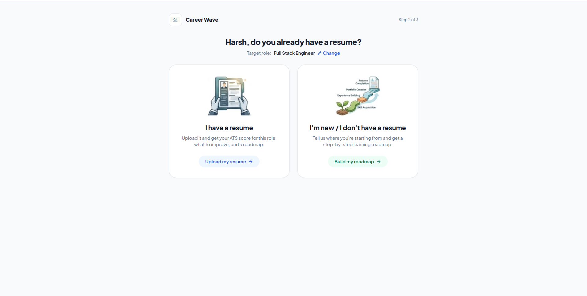
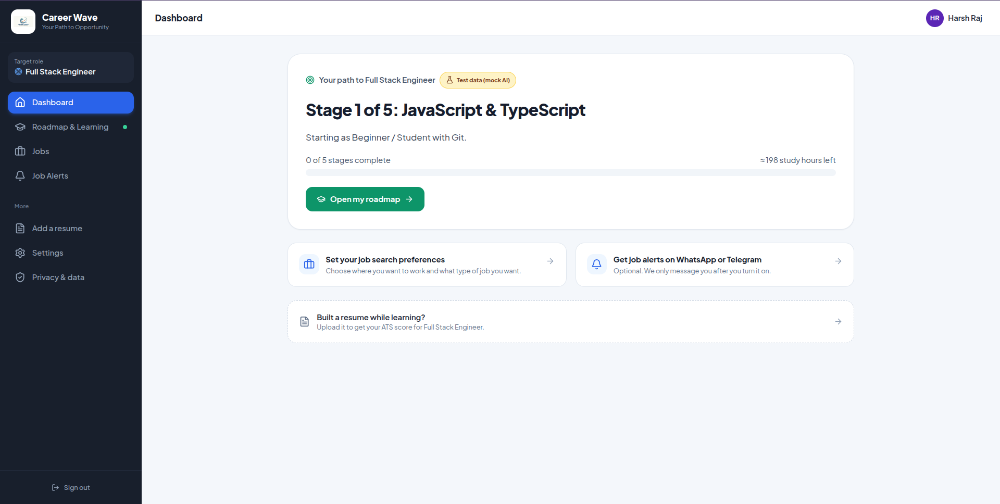
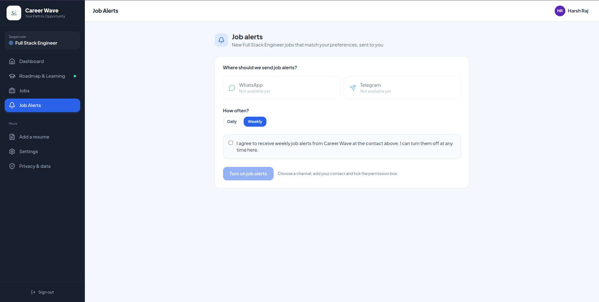

# CareerWave

CareerWave is a career development platform that helps users understand their resume, identify skill gaps, create a learning roadmap, and discover relevant jobs.

The project contains:

- A React + TypeScript frontend built with Vite.
- A Node.js + Express backend.
- Resume parsing for PDF, DOCX, TXT, and common image formats.
- AI-powered resume assessment, improvement suggestions, and career roadmaps.
- Job matching and job-alert preferences.
- Optional Telegram and WhatsApp notification support.

## Product preview

### Starter page

The starter page guides users through authentication, their target role, and the choice between uploading a resume or entering their details manually.



### Career dashboard

The dashboard presents resume scores, strengths, missing skills, improvement suggestions, and the user's next career steps.



### Job alerts

Users can configure job preferences and opt in to job notifications through the supported channels.



## Project structure

```text
CareerWave/
├── Images/                         # README screenshots
├── CareerWave-Backend./
│   └── CareerWave-Backend/
│       ├── src/                    # Express API, AI, auth, routes, services
│       ├── resume-parser/          # Resume extraction and parsing
│       ├── web-parsing/            # Job scraper and notification service
│       ├── tests/                  # Backend tests
│       ├── package.json
│       ├── requirements.txt
│       └── .env.example
├── CareerWave-Frontend./
│   └── CareerWave-Frontend/
│       ├── src/                    # React components, state, API client
│       ├── public/                 # Public assets
│       ├── package.json
│       └── .env.example
├── .gitignore
└── README.md
```

The directory names currently include a trailing period (`CareerWave-Backend.` and `CareerWave-Frontend.`). The commands below use the exact directory names in this workspace.

## Requirements

- Conda
- Node.js and npm
- Python 3.10 or newer

The recommended local environment is the Conda environment named `development`.

## Installation

Activate the environment:

```bash
source "$(conda info --base)/etc/profile.d/conda.sh"
conda activate development
```

If Node.js or Python is not installed in that environment:

```bash
conda install -y -c conda-forge nodejs python=3.11 pip
```

Install backend dependencies:

```bash
cd CareerWave-Backend./CareerWave-Backend
npm install
python -m pip install -r requirements.txt
```

Install frontend dependencies:

```bash
cd ../../CareerWave-Frontend./CareerWave-Frontend
npm install
```

## Configuration

Create local environment files from the provided examples:

```bash
cd ../../CareerWave-Backend./CareerWave-Backend
cp .env.example .env

cd ../../CareerWave-Frontend./CareerWave-Frontend
cp .env.example .env
```

For local development without Auth0 or a real AI API key, use:

Backend `.env`:

```env
AUTH_DISABLED=true
AI_PROVIDER=mock
CORS_ORIGINS=http://localhost:5173
SCRAPE_ON_STARTUP=false
PYTHON_BIN=/absolute/path/to/conda/envs/development/bin/python
```

Frontend `.env`:

```env
VITE_AUTH_DISABLED=true
VITE_API_URL=http://localhost:8080
```

Do not commit `.env` files or API keys. Only `.env.example` files belong in Git.

## Running the application

Open two terminals. Activate the `development` environment in each terminal.

### Backend

```bash
cd CareerWave-Backend./CareerWave-Backend
AUTH_DISABLED=true \
AI_PROVIDER=mock \
CORS_ORIGINS=http://localhost:5173 \
SCRAPE_ON_STARTUP=false \
PYTHON_BIN="$CONDA_PREFIX/bin/python" \
npm run dev
```

The backend runs at:

- API: <http://localhost:8080>
- Health check: <http://localhost:8080/health>
- Notification service: <http://127.0.0.1:8001>

### Frontend

```bash
cd CareerWave-Frontend./CareerWave-Frontend
VITE_AUTH_DISABLED=true \
VITE_API_URL=http://localhost:8080 \
npm run dev -- --host 0.0.0.0
```

The frontend runs at <http://localhost:5173>.

## Available commands

### Backend

```bash
npm start       # Start the backend
npm run dev     # Start with Node watch mode
npm test        # Run backend tests
```

### Frontend

```bash
npm run dev     # Start the Vite development server
npm run build   # Type-check and create a production build
npm run lint    # Run Oxlint
npm run preview # Preview the production build
```

## Main user journey

1. Sign in or use local development mode.
2. Enter a name and target role.
3. Choose whether to upload a resume or provide details manually.
4. Receive resume extraction, ATS scoring, and skill-gap analysis.
5. Review improvement suggestions.
6. Follow a personalized learning roadmap.
7. Search for matching jobs.
8. Optionally configure job alerts.

## Backend API areas

| Area | Purpose |
| --- | --- |
| `/me` | User profile and persisted career state |
| `/resumes` | Resume upload, parsing, and management |
| `/assessments` | ATS score and role alignment |
| `/analysis/improvements` | Resume improvement analysis |
| `/roadmap` | Resume-based and beginner learning roadmaps |
| `/jobs` | Ranked job search results |
| `/users/me/preferences` | Job and notification preferences |
| `/users/me/job-alerts` | Matching job alerts |
| `/api/parse` | Legacy resume parser endpoints |

## Git and ignored files

The repository includes ignore rules at the root and inside both applications:

- [Root `.gitignore`](./.gitignore)
- [Backend `.gitignore`](./CareerWave-Backend./CareerWave-Backend/.gitignore)
- [Frontend `.gitignore`](./CareerWave-Frontend./CareerWave-Frontend/.gitignore)

The ignore rules keep the following out of Git:

- `node_modules/`
- `.env` files and secrets
- User data and uploaded resumes
- Python virtual environments and caches
- Logs, build output, coverage, and temporary files
- Scraper-generated role catalogs
- Editor and operating-system files
- Local PDF, DOCX, and debug artifacts

Source code, lockfiles, tests, documentation, assets, and `.env.example` files remain available to commit.

## Testing

Run backend tests:

```bash
cd CareerWave-Backend./CareerWave-Backend
npm test
```

Build the frontend:

```bash
cd CareerWave-Frontend./CareerWave-Frontend
npm run build
```

## Security notes

- Keep AI, Auth0, Telegram, and WhatsApp credentials on the backend only.
- Never place private API keys in frontend variables exposed through `VITE_*`.
- Keep `AUTH_DISABLED=true` and `AI_PROVIDER=mock` limited to local development and tests.
- Review `.gitignore` before the first commit to ensure local data and secrets are not staged.
